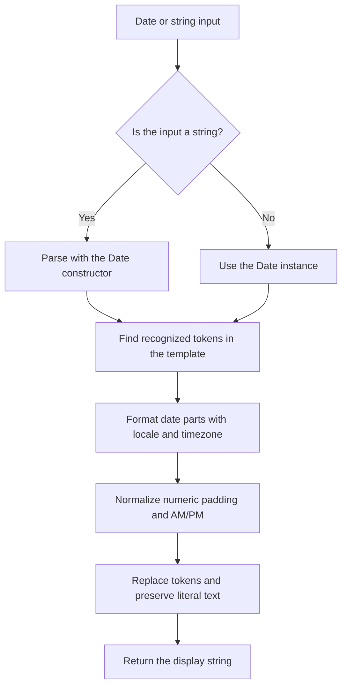

# Overview

## What the package does

Use `@atom-forge/date-format` to display a date or time with an explicit template. It is useful for UI labels, reports, and strings where your application chooses the order of fields and their separators while still needing localized month or weekday names.

The package has no runtime package dependencies. It provides one ESM named export, `dateFormat`, with TypeScript declarations.

## Choosing the right tool

| Requirement | Recommended tool |
| --- | --- |
| Explicit template with localized date fields | `dateFormat` |
| Locale-selected date layout | `Intl.DateTimeFormat` directly |
| ISO timestamp serialization | `Date.prototype.toISOString()` |
| Relative text such as “three minutes ago” | `Intl.RelativeTimeFormat` with application logic |
| Custom input parsing, date arithmetic, or scheduling | A separate solution appropriate to the task |

> [!warning] Formatting is not parsing
> A string input is passed to JavaScript's `Date` constructor. The format template describes the output, not the input. The package does not parse custom input patterns or validate form fields.

## How formatting works

Internally, the package extracts individual parts with `Intl.DateTimeFormat.formatToParts` and caches formatters by token, locale, and timezone. Callers do not need to manage these formatters.

Formatting does not mutate the input date. Supplying a timezone changes how an instant is displayed; it does not create a different instant.

> [!tip] Keep display and storage separate
> Store instants in a suitable timestamp representation and format them when displaying them. A formatted UI string is not a replacement for a timestamp.

Continue with [[02-usage|Installation and API]].
