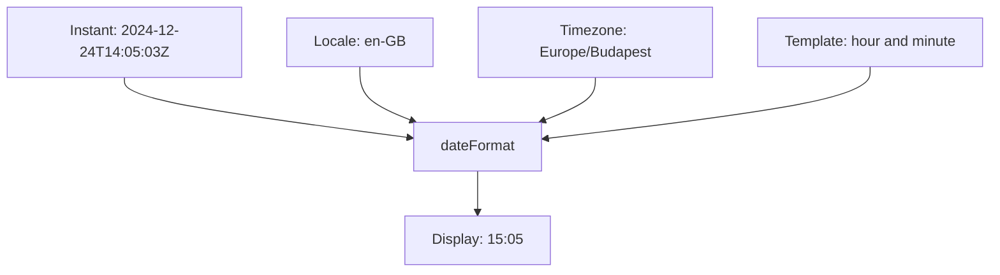

# Locales and timezones

## Three independent choices

A template chooses layout, a locale chooses localized field representations, and a timezone determines which date/time fields represent the instant.



Changing the locale does not automatically rearrange the template. Changing the timezone does not change the underlying instant.

## Localized names

```ts
import { dateFormat } from "@atom-forge/date-format";

const instant = new Date("2024-12-24T14:05:03Z");

dateFormat("$M %d, %Y", instant, "en-GB", "UTC");
// "December 24, 2024"

dateFormat("%Y. $M %d.", instant, "hu-HU", "UTC");
// "2024. december 24."
```

> [!warning] Locale affects more than names
> A locale can affect digits and calendar behavior too. Do not assume every locale produces ASCII digits or Gregorian years. This package does not force one numbering system or calendar for all locales.

## One instant, different clocks

```ts
dateFormat("%H:%I", instant, "en-GB", "UTC");
// "14:05"

dateFormat("%H:%I", instant, "en-GB", "Europe/Budapest");
// "15:05"

dateFormat("%H:%I", instant, "en-GB", "America/New_York");
// "09:05"
```

These offsets apply to this particular winter date. Named timezones account for daylight saving changes through the runtime's timezone data. Do not implement timezone formatting by manually adding a fixed number of hours.

> [!note] Timezone names are display labels
> `$z` and `$Z` may produce abbreviations, full names, or offsets depending on locale and runtime. Do not use these labels as stable identifiers. Keep an identifier such as `Europe/Budapest` separately.

## Parsing strings safely

The locale parameter does not tell JavaScript how to parse a date string. Strings are passed to `new Date` before formatting.

| Input | Interpretation |
| --- | --- |
| `2024-12-24T14:05:03Z` | Explicit UTC instant |
| `2024-12-24T15:05:03+01:00` | The same instant with an explicit offset |
| `2024-12-24T14:05:03` | Date-time interpreted in the runtime's local timezone |
| `2024-12-24` | ISO date-only string interpreted as UTC midnight |

> [!danger] A calendar date is not necessarily an instant
> A birthday or billing date may represent a timezone-free calendar date. This package does not model that concept. Converting it to UTC midnight and then displaying it in another timezone can move it to the previous day.

For example:

```ts
dateFormat("%Y-%M-%D", "2024-12-24", "en-GB", "America/New_York");
// "2024-12-23"
```

That output follows JavaScript's date parsing and timezone conversion; it is not a custom date-only parsing feature.

## What a timezone parameter cannot do

A `timeZone` argument only controls display. It does not interpret a string without an offset as a wall-clock time in that named timezone. Convert or resolve such inputs into an instant with a suitable separate solution before formatting.

Continue with [[05-recipes-and-testing|Recipes and testing]].
