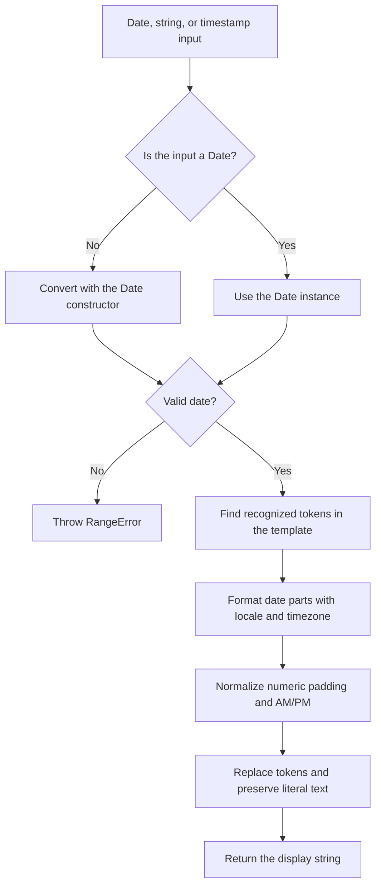
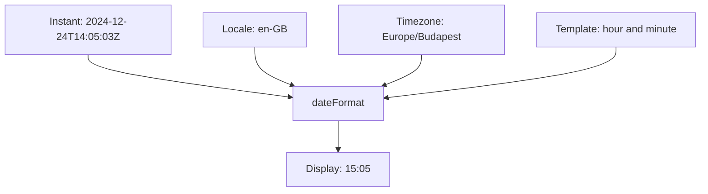

<!-- Derived from the book in book/ (https://books.atom-forge.eu). Change the book first, then update this file and docs/hu/index.md. -->

# Date formatting with @atom-forge/date-format

`@atom-forge/date-format` is a lightweight JavaScript/TypeScript date formatter built on `Intl.DateTimeFormat`. Templates control field order and separators; the locale and timezone control the displayed values.

This guide takes you from choosing the package to writing predictable templates and handling localization and timezones safely.

> **What you will learn**
>
> When to choose this package, how to call `dateFormat`, what each token means, and how to avoid surprises caused by date parsing and runtime timezone defaults.

## Contents

- [Overview](#overview)
- [Installation and API](#installation-and-api)
- [Tokens and templates](#tokens-and-templates)
- [Locales and timezones](#locales-and-timezones)
- [Recipes and testing](#recipes-and-testing)
- [Upgrading](#upgrading)

> **Note: Predictable examples**
>
> Examples generally use an explicit instant and timezone rather than the current time or your machine's timezone. Localized wording still depends on the runtime's internationalization data.

## Overview

### What the package does

Use `@atom-forge/date-format` to display a date or time with an explicit template. It is useful for UI labels, reports, and strings where your application chooses the order of fields and their separators while still needing localized month or weekday names.

The package has no runtime package dependencies. It provides one ESM named export, `dateFormat`, with TypeScript declarations.

### Choosing the right tool

| Requirement | Recommended tool |
| --- | --- |
| Explicit template with localized date fields | `dateFormat` |
| Locale-selected date layout | `Intl.DateTimeFormat` directly |
| ISO timestamp serialization | `Date.prototype.toISOString()` |
| Relative text such as “three minutes ago” | `Intl.RelativeTimeFormat` with application logic |
| Custom input parsing, date arithmetic, or scheduling | A separate solution appropriate to the task |

> **Warning: Formatting is not parsing**
>
> A string or numeric input is passed to JavaScript's `Date` constructor. The format template describes the output, not the input. The package does not parse custom input patterns or validate form fields.

### How formatting works



Internally, the package extracts individual parts with `Intl.DateTimeFormat.formatToParts` and caches formatters by token, locale, and timezone. Callers do not need to manage these formatters.

Formatting does not mutate the input date. Supplying a timezone changes how an instant is displayed; it does not create a different instant.

> **Tip: Keep display and storage separate**
>
> Store instants in a suitable timestamp representation and format them when displaying them. A formatted UI string is not a replacement for a timestamp.

## Installation and API

### Install

Choose the command for your package manager:

```sh
npm install @atom-forge/date-format
```

```sh
bun add @atom-forge/date-format
```

### First example

```ts
import { dateFormat } from "@atom-forge/date-format";

const instant = new Date("2024-12-24T14:05:03Z");

const label = dateFormat("%Y-%M-%D %H:%I", instant, "en-GB", "UTC");
// "2024-12-24 14:05"
```

### Signature

```ts
function dateFormat(
  format: string,
  date?: Date | string | number,
  lang?: string,
  timeZone?: string,
): string;
```

| Parameter | Meaning | Default |
| --- | --- | --- |
| `format` | Case-sensitive tokens and literal text | Required |
| `date` | A `Date` instance, a string parsed by `new Date`, or epoch milliseconds | Current time |
| `lang` | Locale used by the internationalization APIs | `"en-GB"` |
| `timeZone` | Timezone identifier, such as `"UTC"` or `"Europe/Budapest"` | Runtime's default timezone |

The return value is a string. There is no options object or additional configuration API.

An invalid date throws a `RangeError`, and `null` throws a `TypeError`; see [Recipes and testing](#recipes-and-testing) for validating external input.

### Input variants

A string with an explicit offset identifies an instant:

```ts
dateFormat("%H:%I", "2024-12-24T14:05:03Z", "en-GB", "UTC");
// "14:05"
```

Numeric timestamps (epoch milliseconds) are accepted as well:

```ts
const timestamp = Date.parse("2024-12-24T14:05:03Z");
dateFormat("%Y-%M-%D", timestamp, "en-GB", "UTC");
// "2024-12-24"
```

To use the current time while specifying a locale or timezone, pass `undefined` for the date:

```ts
dateFormat("%Y-%M-%D", undefined, "en-GB", "Europe/Budapest");
```

> **Warning: Defaults are environment-dependent**
>
> Omitting the date uses the current time. Omitting the timezone uses the runtime's timezone, not necessarily UTC. Supply both explicitly in tests and whenever output must be consistent across machines.

> **Note: Runtime requirements**
>
> The runtime must support `Intl.DateTimeFormat`, `formatToParts`, and the locale/timezone data you need. The package also uses `Intl.NumberFormat` for localized numeric padding.

## Tokens and templates

Templates consist of recognized, case-sensitive tokens and literal text. Numeric fields use `%`; localized text fields use `$`.

### Numeric tokens

The examples below use `en-GB` digits.

| Token | Meaning | Example |
| --- | --- | --- |
| `%Y` | Full year | `2024` |
| `%y` | Two-digit year | `24` |
| `%m` | Unpadded month | `4` |
| `%M` | Two-digit month | `04` |
| `%d` | Unpadded day of month | `7` |
| `%D` | Two-digit day of month | `07` |
| `%h` | Unpadded 24-hour clock hour | `9` |
| `%H` | Two-digit 24-hour clock hour | `09` |
| `%g` | Unpadded 12-hour clock hour | `2` |
| `%G` | Two-digit 12-hour clock hour | `02` |
| `%i` | Unpadded minute | `5` |
| `%I` | Two-digit minute | `05` |
| `%s` | Unpadded second | `3` |
| `%S` | Two-digit second | `03` |
| `%L` | Three-digit milliseconds | `007` |
| `%z` | UTC offset, locale-independent | `+01:00` |

Uppercase month, day, hour, minute, and second tokens use two digits. Year tokens are the exception: `%Y` is the full year and `%y` is the two-digit year. `%Y` is not zero-padded (year 33 renders as `33`) and has no era marker. The 24-hour tokens use the 00–23 cycle; 12-hour tokens use 1–12 before padding.

`%z` always uses ASCII characters, independently of the locale: `+01:00`, `-05:00`, or `+00:00` for UTC.

> **Warning: Month is not minute**
>
> `%M` means two-digit **month**. Use `%I` for two-digit **minutes**. These are package-specific tokens, not Moment, date-fns, or standard `strftime` patterns.

### Text tokens

| Token | Meaning | Illustrative English output |
| --- | --- | --- |
| `$m` | Short month name | `Dec` |
| `$M` | Long month name | `December` |
| `$d` | Narrow weekday | `T` |
| `$w` | Short weekday | `Tue` |
| `$D` | Long weekday | `Tuesday` |
| `$W` | Long weekday, alias of `$D` | `Tuesday` |
| `$p` | Conventional AM/PM marker | `am` or `pm` |
| `$P` | Localized long day period | `in the afternoon` |
| `$z` | Short timezone name | `UTC` or an offset such as `GMT+1` |
| `$Z` | Long timezone name | `Coordinated Universal Time` |

Text depends on locale and runtime internationalization data. When the template also contains `%d` or `%D`, month names use the locale's contextual form, so inflecting languages get the correct case (Russian `24 декабря`, not `24 декабрь`). Punctuation in localized names is preserved. `$p` always uses lowercase `am` or `pm`, independently of the chosen locale; `$P` is localized.

> **Note: Similar names, different fields**
>
> `%D` is the day of the month, while `$D` is the weekday name. A narrow weekday such as `$d` is compact but may not uniquely identify a weekday.

### Combining tokens

```ts
import { dateFormat } from "@atom-forge/date-format";

const instant = new Date("2024-12-24T14:05:03Z");

dateFormat("$D, $M %d, %Y", instant, "en-GB", "UTC");
// "Tuesday, December 24, 2024"

dateFormat("%g:%I $p", instant, "en-GB", "UTC");
// "2:05 pm"

dateFormat("%Y/%Y", instant, "en-GB", "UTC");
// "2024/2024"

dateFormat("%Y-%M-%DT%H:%I:%S%z", instant, "en-GB", "Europe/Budapest");
// "2024-12-24T15:05:03+01:00"
```

### Literals and unsupported patterns

Recognized tokens are replaced wherever they occur, including repeated occurrences. Unrecognized text stays unchanged:

```ts
dateFormat("YYYY-MM-DD", instant, "en-GB", "UTC");
// "YYYY-MM-DD"
```

To output a literal `%` or `$`, double it. Quoting a token does not escape it:

```ts
dateFormat("50%%off on %d $$M", instant, "en-GB", "UTC");
// "50%off on 24 $M"
```

> **Tip: Translate patterns explicitly**
>
> When migrating from another library, translate each field using this table instead of copying the old template. Unsupported patterns are not rejected; they remain literal text.

## Locales and timezones

### Three independent choices

A template chooses layout, a locale chooses localized field representations, and a timezone determines which date/time fields represent the instant.



Changing the locale does not automatically rearrange the template. Changing the timezone does not change the underlying instant.

### Localized names

```ts
import { dateFormat } from "@atom-forge/date-format";

const instant = new Date("2024-12-24T14:05:03Z");

dateFormat("$M %d, %Y", instant, "en-GB", "UTC");
// "December 24, 2024"

dateFormat("%Y. $M %d.", instant, "hu-HU", "UTC");
// "2024. december 24."
```

> **Warning: Locale affects more than names**
>
> A locale can affect digits and calendar behavior too. Do not assume every locale produces ASCII digits or Gregorian years. This package does not force one numbering system or calendar for all locales. For calendars without a numeric year, such as `zh-CN-u-ca-chinese`, `%Y` falls back to the related Gregorian year.

### Month names in context

When the template contains a day of month (`%d` or `%D`), `$M` and `$m` use the locale's contextual month form. In inflecting languages this is a different grammatical case than the standalone name:

```ts
dateFormat("%d $M %Y", instant, "ru-RU", "UTC");
// "24 декабря 2024"

dateFormat("$M %Y", instant, "ru-RU", "UTC");
// "декабрь 2024"
```

Some locales include a particle in the contextual form: Catalan renders `%d $M` as `24 de desembre`, so do not add `de` to the template yourself. If a locale only offers a numeric month next to a day, the standalone name is used.

### One instant, different clocks

```ts
dateFormat("%H:%I", instant, "en-GB", "UTC");
// "14:05"

dateFormat("%H:%I", instant, "en-GB", "Europe/Budapest");
// "15:05"

dateFormat("%H:%I", instant, "en-GB", "America/New_York");
// "09:05"
```

These offsets apply to this particular winter date. Named timezones account for daylight saving changes through the runtime's timezone data. Do not implement timezone formatting by manually adding a fixed number of hours.

> **Note: Timezone names are display labels**
>
> `$z` and `$Z` may produce abbreviations, full names, or offsets depending on locale and runtime. Do not use these labels as stable identifiers. Keep an identifier such as `Europe/Budapest` separately.

### Parsing strings safely

The locale parameter does not tell JavaScript how to parse a date string. Strings are passed to `new Date` before formatting.

| Input | Interpretation |
| --- | --- |
| `2024-12-24T14:05:03Z` | Explicit UTC instant |
| `2024-12-24T15:05:03+01:00` | The same instant with an explicit offset |
| `2024-12-24T14:05:03` | Date-time interpreted in the runtime's local timezone |
| `2024-12-24` | ISO date-only string interpreted as UTC midnight |

> **Danger: A calendar date is not necessarily an instant**
>
> A birthday or billing date may represent a timezone-free calendar date. This package does not model that concept. Converting it to UTC midnight and then displaying it in another timezone can move it to the previous day.

For example:

```ts
dateFormat("%Y-%M-%D", "2024-12-24", "en-GB", "America/New_York");
// "2024-12-23"
```

That output follows JavaScript's date parsing and timezone conversion; it is not a custom date-only parsing feature.

### What a timezone parameter cannot do

A `timeZone` argument only controls display. It does not interpret a string without an offset as a wall-clock time in that named timezone. Convert or resolve such inputs into an instant with a suitable separate solution before formatting.

## Recipes and testing

### Display a report timestamp

Use an explicit locale and timezone for reports that must be consistent across environments:

```ts
import { dateFormat } from "@atom-forge/date-format";

const instant = new Date("2024-12-24T14:05:03Z");
const timestamp = dateFormat("%Y-%M-%D %H:%I:%S", instant, "en-GB", "UTC");
// "2024-12-24 14:05:03"
```

> **Warning: This is a display string, not ISO serialization**
>
> A template can look like a timestamp without being a portable serialization format. For an ISO representation of the instant in UTC, use `instant.toISOString()`; to include the offset of a named timezone, use `"%Y-%M-%DT%H:%I:%S%z"` with an ASCII-digit locale such as `en-GB`.

### Centralize your UI defaults

An application-level wrapper keeps locale and timezone decisions in one place:

```ts
import { dateFormat } from "@atom-forge/date-format";

function formatEventDate(date: Date | string): string {
  return dateFormat("$M %d, %Y — %H:%I", date, "en-GB", "Europe/Budapest");
}

formatEventDate("2024-12-24T14:05:03Z");
// "December 24, 2024 — 15:05"
```

If users have preferences, pass their locale and timezone through your application wrapper instead of relying on the server's defaults.

### Validate external input

An invalid date makes `dateFormat` throw a `RangeError`; invalid locale syntax or timezone identifiers make the underlying Intl APIs throw. The package does not supply a fallback.

```ts
import { dateFormat } from "@atom-forge/date-format";

function formatExternalTimestamp(input: string): string {
  const date = new Date(input);
  if (Number.isNaN(date.getTime())) {
    throw new RangeError("Expected a valid timestamp");
  }

  return dateFormat("%Y-%M-%D %H:%I", date, "en-GB", "UTC");
}
```

> **Note: Valid does not mean unambiguous**
>
> Checking `getTime()` only detects an invalid JavaScript date. It does not enforce a strict input format or detect every normalized calendar value. Validate your input contract separately; prefer explicit offsets for instants.

Avoid depending on token-free templates to validate dates or configuration: when no recognized token is present, no date formatting is performed.

### Write reproducible tests

Use a fixed input date, locale, and timezone. The following test uses Node's built-in test runner:

```js
import assert from "node:assert/strict";
import test from "node:test";
import { dateFormat } from "@atom-forge/date-format";

test("formats a timestamp in UTC", () => {
  assert.equal(
    dateFormat("%Y-%M-%D %H:%I:%S", "2024-12-24T14:05:03Z", "en-GB", "UTC"),
    "2024-12-24 14:05:03",
  );
});

test("formats the same instant in Budapest", () => {
  assert.equal(
    dateFormat("%H:%I", "2024-12-24T14:05:03Z", "en-GB", "Europe/Budapest"),
    "15:05",
  );
});
```

> **Tip: Test the behavior you depend on**
>
> Cover numeric padding, midnight, date boundaries, and daylight saving transitions if they matter to your application. Avoid cross-runtime assertions that require one particular spelling of a timezone name or localized day period.

### Troubleshooting checklist

| Symptom | Check |
| --- | --- |
| Template appears unchanged | Are you using this package's tokens rather than `YYYY`, `MM`, or `DD`? |
| Month appears where minutes should be | Replace `%M` with `%I` in the time field. |
| Date differs between server and browser | Supply an explicit timezone and inspect the input offset. |
| Date-only value moves to the previous day | Check whether UTC midnight is being displayed in another timezone. |
| Text differs across machines | Check locale support and internationalization data. |
| Formatting throws | Validate the date and inspect locale/timezone arguments. |

## Upgrading

This chapter lists the changes that may require action when you upgrade. Each version section covers the step from the previous published version; read every section between your current and your target version. Changes that need no action, such as new features and internal improvements, are listed only in the changelog.

### From 0.1.5 to 0.1.6

#### Invalid and `null` dates throw

`dateFormat` now validates the `date` argument itself before formatting.

| Input | 0.1.5 | 0.1.6 |
| --- | --- | --- |
| `null` | Formatted the Unix epoch, e.g. `"1970"` for `%Y` | Throws `TypeError` |
| Invalid date, e.g. `"nonsense"` or `new Date(NaN)` | `RangeError: Invalid time value` from `Intl` | `RangeError: dateFormat: invalid date: nonsense` |
| Template without tokens and an invalid date | Returned the template unchanged | Throws `RangeError` |

**What to do:** Do not pass `null` where "no date" is possible; pass `undefined` for the current time or skip formatting. If you match on the error message, match on `RangeError` instead of the text `Invalid time value`.

#### `%L`, `%z`, `%%` and `$$` are now recognized

`%L` (milliseconds) and `%z` (UTC offset) are new tokens, and doubled prefixes now escape a literal `%` or `$`. Templates that contained these sequences as literal text produce different output.

| Template | 0.1.5 | 0.1.6 |
| --- | --- | --- |
| `"%Y%%"` | `"2024%%"` | `"2024%"` |
| `"%%Y"` | `"%2024"` | `"%Y"` |
| `"$$M"` | `"$December"` | `"$M"` |
| `"%H:%I %z"` (UTC) | `"14:05 %z"` | `"14:05 +00:00"` |

**What to do:** Search your templates for `%%`, `$$`, `%L` and `%z`. Where a literal `%` or `$` should appear, double it; where a token should follow a literal prefix character, write the prefix doubled followed by the token, e.g. `"$$$M"` for `"$December"`.

#### Month names next to a day of month use the contextual form

When the template contains `%d` or `%D`, `$M` and `$m` now use the locale's contextual month form instead of the standalone one. English, Hungarian, German and French output is unchanged; inflecting languages now get the grammatically correct case.

| Template and locale | 0.1.5 | 0.1.6 |
| --- | --- | --- |
| `"%d $M %Y"`, `ru-RU` | `"24 декабрь 2024"` | `"24 декабря 2024"` |
| `"%d $M"`, `pl-PL` | `"24 grudzień"` | `"24 grudnia"` |
| `"%d $M"`, `fi-FI` | `"24 joulukuu"` | `"24 joulukuuta"` |
| `"%d $M"`, `ca-ES` | `"24 desembre"` | `"24 de desembre"` |
| `"$M %Y"`, `ru-RU` | `"декабрь 2024"` | `"декабрь 2024"` (no day, unchanged) |

**What to do:** If you worked around the wrong case, remove the workaround. Check templates for locales whose contextual form contains a particle: a Catalan template written as `"%d de $M"` now renders `"24 de de desembre"`; write `"%d $M"` instead. Update test snapshots that contain month names next to a day.
