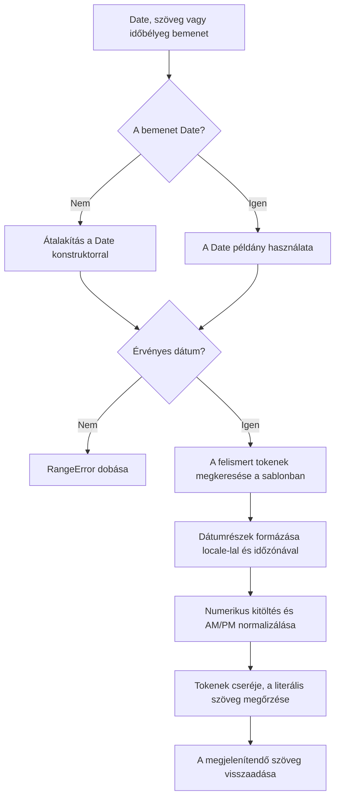
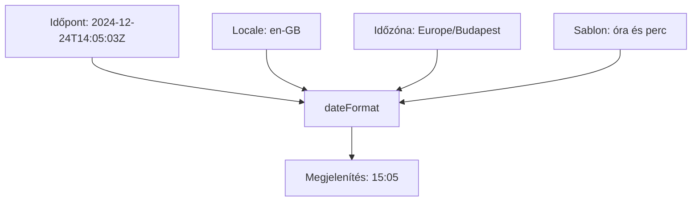

<!-- A docs/en/index.md magyar fordítása. Előbb a book/ változzon, aztán a docs/en/index.md, végül ez a fájl, szakaszról szakaszra. -->

# Dátumformázás az @atom-forge/date-format csomaggal

Az `@atom-forge/date-format` egy könnyűsúlyú JavaScript/TypeScript dátumformázó, amely az `Intl.DateTimeFormat`-ra épül. A sablon határozza meg a mezők sorrendjét és az elválasztókat, a locale és az időzóna pedig a megjelenített értékeket.

Ez az útmutató a csomag kiválasztásától a kiszámítható sablonok írásán át a lokalizáció és az időzónák biztonságos kezeléséig vezet.

> **Miről szól ez az útmutató**
>
> Mikor érdemes ezt a csomagot választani, hogyan kell meghívni a `dateFormat`-ot, mit jelentenek az egyes tokenek, és hogyan kerülhetők el a dátumértelmezésből és a futtatókörnyezet alapértelmezett időzónájából adódó meglepetések.

## Tartalom

- [Áttekintés](#áttekintés)
- [Telepítés és API](#telepítés-és-api)
- [Tokenek és sablonok](#tokenek-és-sablonok)
- [Locale-ok és időzónák](#locale-ok-és-időzónák)
- [Receptek és tesztelés](#receptek-és-tesztelés)
- [Frissítés](#frissítés)

> **Megjegyzés: Kiszámítható példák**
>
> A példák általában explicit időpontot és időzónát használnak, nem az aktuális időt vagy a gép időzónáját. A lokalizált szövegek ettől még függenek a futtatókörnyezet nemzetköziesítési adataitól.

## Áttekintés

### Mire való a csomag

Az `@atom-forge/date-format` dátumok és időpontok megjelenítésére szolgál explicit sablonnal. Hasznos UI-feliratokhoz, riportokhoz és minden olyan szöveghez, ahol az alkalmazás dönti el a mezők sorrendjét és az elválasztókat, de lokalizált hónap- vagy hétnapnevekre is szükség van.

A csomagnak nincs futásidejű függősége. Egyetlen ESM nevesített exportot ad, a `dateFormat`-ot, TypeScript deklarációkkal.

### A megfelelő eszköz kiválasztása

| Igény | Javasolt eszköz |
| --- | --- |
| Explicit sablon lokalizált dátummezőkkel | `dateFormat` |
| A locale által választott dátumelrendezés | Közvetlenül az `Intl.DateTimeFormat` |
| ISO időbélyeg szerializálása | `Date.prototype.toISOString()` |
| Relatív szöveg, például „három perce” | `Intl.RelativeTimeFormat` alkalmazáslogikával |
| Egyedi bemenetértelmezés, dátumaritmetika vagy ütemezés | A feladathoz illő külön megoldás |

> **Figyelem: A formázás nem értelmezés**
>
> A szöveges vagy numerikus bemenet a JavaScript `Date` konstruktorához kerül. A formátumsablon a kimenetet írja le, nem a bemenetet. A csomag nem értelmez egyedi bemeneti mintákat, és nem validál űrlapmezőket.

### Hogyan működik a formázás



Belül a csomag az `Intl.DateTimeFormat.formatToParts` segítségével nyeri ki az egyes részeket, a formattereket pedig token, locale és időzóna szerint gyorsítótárazza. A hívónak ezekkel nem kell foglalkoznia.

A formázás nem módosítja a bemeneti dátumot. Az időzóna megadása azt változtatja meg, hogyan jelenik meg egy időpont, de nem hoz létre másik időpontot.

> **Tipp: Válaszd külön a megjelenítést és a tárolást**
>
> Az időpontokat megfelelő időbélyeg-formában tárold, és csak megjelenítéskor formázd. Egy formázott UI-szöveg nem helyettesíti az időbélyeget.

## Telepítés és API

### Telepítés

Válaszd a csomagkezelődnek megfelelő parancsot:

```sh
npm install @atom-forge/date-format
```

```sh
bun add @atom-forge/date-format
```

### Első példa

```ts
import { dateFormat } from "@atom-forge/date-format";

const instant = new Date("2024-12-24T14:05:03Z");

const label = dateFormat("%Y-%M-%D %H:%I", instant, "en-GB", "UTC");
// "2024-12-24 14:05"
```

### Szignatúra

```ts
function dateFormat(
  format: string,
  date?: Date | string | number,
  lang?: string,
  timeZone?: string,
): string;
```

| Paraméter | Jelentés | Alapértelmezés |
| --- | --- | --- |
| `format` | Kis- és nagybetűérzékeny tokenek és literális szöveg | Kötelező |
| `date` | `Date` példány, a `new Date` által értelmezett szöveg vagy epoch ezredmásodperc | Aktuális idő |
| `lang` | A nemzetköziesítési API-k által használt locale | `"en-GB"` |
| `timeZone` | Időzóna-azonosító, például `"UTC"` vagy `"Europe/Budapest"` | A futtatókörnyezet alapértelmezett időzónája |

A visszatérési érték szöveg. Nincs opciós objektum vagy további konfigurációs API.

Érvénytelen dátumra `RangeError`, `null`-ra `TypeError` keletkezik; a külső bemenet validálásáról a [Receptek és tesztelés](#receptek-és-tesztelés) fejezet szól.

### Bemeneti változatok

Az explicit eltolást tartalmazó szöveg egyértelmű időpontot jelöl:

```ts
dateFormat("%H:%I", "2024-12-24T14:05:03Z", "en-GB", "UTC");
// "14:05"
```

Numerikus időbélyeg (epoch ezredmásodperc) is megadható:

```ts
const timestamp = Date.parse("2024-12-24T14:05:03Z");
dateFormat("%Y-%M-%D", timestamp, "en-GB", "UTC");
// "2024-12-24"
```

Ha az aktuális időt szeretnéd használni, de locale-t vagy időzónát is megadsz, a dátum helyére `undefined`-ot írj:

```ts
dateFormat("%Y-%M-%D", undefined, "en-GB", "Europe/Budapest");
```

> **Figyelem: Az alapértelmezések környezetfüggők**
>
> A dátum elhagyásakor az aktuális idő lesz használva. Az időzóna elhagyásakor a futtatókörnyezet időzónája, ami nem feltétlenül UTC. Tesztekben, és ahol a kimenetnek gépenként azonosnak kell lennie, mindkettőt add meg explicit módon.

> **Megjegyzés: Futtatókörnyezeti követelmények**
>
> A futtatókörnyezetnek támogatnia kell az `Intl.DateTimeFormat`-ot, a `formatToParts`-ot, valamint a szükséges locale- és időzóna-adatokat. A csomag a lokalizált numerikus kitöltéshez az `Intl.NumberFormat`-ot is használja.

## Tokenek és sablonok

A sablon felismert, kis- és nagybetűérzékeny tokenekből és literális szövegből áll. A numerikus mezők `%`, a lokalizált szöveges mezők `$` előtagot használnak.

### Numerikus tokenek

Az alábbi példák `en-GB` számjegyeket használnak.

| Token | Jelentés | Példa |
| --- | --- | --- |
| `%Y` | Teljes évszám | `2024` |
| `%y` | Kétjegyű évszám | `24` |
| `%m` | Hónap kitöltés nélkül | `4` |
| `%M` | Kétjegyű hónap | `04` |
| `%d` | A hónap napja kitöltés nélkül | `7` |
| `%D` | A hónap napja két számjeggyel | `07` |
| `%h` | Óra 24 órás formában, kitöltés nélkül | `9` |
| `%H` | Óra 24 órás formában, két számjeggyel | `09` |
| `%g` | Óra 12 órás formában, kitöltés nélkül | `2` |
| `%G` | Óra 12 órás formában, két számjeggyel | `02` |
| `%i` | Perc kitöltés nélkül | `5` |
| `%I` | Kétjegyű perc | `05` |
| `%s` | Másodperc kitöltés nélkül | `3` |
| `%S` | Kétjegyű másodperc | `03` |
| `%L` | Háromjegyű ezredmásodperc | `007` |
| `%z` | UTC-eltolás, locale-tól független | `+01:00` |

A nagybetűs hónap-, nap-, óra-, perc- és másodperc-tokenek két számjegyet adnak. Az évszám a kivétel: a `%Y` a teljes évszám, a `%y` a kétjegyű. A `%Y` nincs nullákkal kitöltve (a 33-as év `33` lesz), és nem jelöl korszakot. A 24 órás tokenek a 00–23 tartományt használják, a 12 órásak kitöltés előtt az 1–12-t.

A `%z` a locale-tól függetlenül mindig ASCII karaktereket ad: `+01:00`, `-05:00`, UTC esetén `+00:00`.

> **Figyelem: A hónap nem perc**
>
> A `%M` kétjegyű **hónapot** jelent. Kétjegyű **perchez** a `%I`-t használd. Ezek a csomag saját tokenjei, nem Moment-, date-fns- vagy szabványos `strftime`-minták.

### Szöveges tokenek

| Token | Jelentés | Angol példakimenet |
| --- | --- | --- |
| `$m` | Rövid hónapnév | `Dec` |
| `$M` | Hosszú hónapnév | `December` |
| `$d` | Legrövidebb hétnapnév | `T` |
| `$w` | Rövid hétnapnév | `Tue` |
| `$D` | Hosszú hétnapnév | `Tuesday` |
| `$W` | Hosszú hétnapnév, a `$D` aliasa | `Tuesday` |
| `$p` | Hagyományos AM/PM jelölés | `am` vagy `pm` |
| `$P` | Lokalizált, hosszú napszak | `in the afternoon` |
| `$z` | Rövid időzónanév | `UTC` vagy eltolás, például `GMT+1` |
| `$Z` | Hosszú időzónanév | `Coordinated Universal Time` |

A szöveg a locale-tól és a futtatókörnyezet nemzetköziesítési adataitól függ. Ha a sablonban `%d` vagy `%D` is szerepel, a hónapnevek a locale szövegkörnyezeti alakját használják, így a ragozó nyelvek a helyes esetet kapják (oroszul `24 декабря`, nem `24 декабрь`). A lokalizált nevek írásjelei megmaradnak. A `$p` a választott locale-tól függetlenül mindig kisbetűs `am` vagy `pm`; a `$P` lokalizált.

> **Megjegyzés: Hasonló név, más mező**
>
> A `%D` a hónap napja, a `$D` pedig a hét napjának neve. A legrövidebb hétnapnév (`$d`) tömör, de nem feltétlenül azonosítja egyértelműen a napot.

### Tokenek kombinálása

```ts
import { dateFormat } from "@atom-forge/date-format";

const instant = new Date("2024-12-24T14:05:03Z");

dateFormat("$D, $M %d, %Y", instant, "en-GB", "UTC");
// "Tuesday, December 24, 2024"

dateFormat("%g:%I $p", instant, "en-GB", "UTC");
// "2:05 pm"

dateFormat("%Y/%Y", instant, "en-GB", "UTC");
// "2024/2024"

dateFormat("%Y-%M-%DT%H:%I:%S%z", instant, "en-GB", "Europe/Budapest");
// "2024-12-24T15:05:03+01:00"
```

### Literálok és nem támogatott minták

A felismert tokenek mindenhol cserélődnek, ahol előfordulnak, ismétlődés esetén is. A fel nem ismert szöveg változatlan marad:

```ts
dateFormat("YYYY-MM-DD", instant, "en-GB", "UTC");
// "YYYY-MM-DD"
```

Literális `%` vagy `$` kiírásához duplázd meg a karaktert. Az idézőjelek nem védik a tokeneket:

```ts
dateFormat("50%%off on %d $$M", instant, "en-GB", "UTC");
// "50%off on 24 $M"
```

> **Tipp: Fordítsd át a mintákat egyenként**
>
> Másik könyvtárról átálláskor a fenti táblázat alapján fordíts át minden mezőt, ne másold át a régi sablont. A nem támogatott mintákat a csomag nem utasítja el, egyszerűen literális szövegként hagyja őket.

## Locale-ok és időzónák

### Három független döntés

A sablon az elrendezést választja meg, a locale a mezők lokalizált megjelenését, az időzóna pedig azt, hogy mely dátum- és időmezők felelnek meg az időpontnak.



A locale megváltoztatása nem rendezi át automatikusan a sablont. Az időzóna megváltoztatása nem változtatja meg a mögöttes időpontot.

### Lokalizált nevek

```ts
import { dateFormat } from "@atom-forge/date-format";

const instant = new Date("2024-12-24T14:05:03Z");

dateFormat("$M %d, %Y", instant, "en-GB", "UTC");
// "December 24, 2024"

dateFormat("%Y. $M %d.", instant, "hu-HU", "UTC");
// "2024. december 24."
```

> **Figyelem: A locale nemcsak a neveket befolyásolja**
>
> A locale a számjegyekre és a naptárra is hatással lehet. Ne feltételezd, hogy minden locale ASCII számjegyeket vagy Gergely-naptár szerinti évszámot ad. A csomag nem kényszerít egyetlen számrendszert vagy naptárt minden locale-ra. Numerikus évszám nélküli naptáraknál, például `zh-CN-u-ca-chinese` esetén, a `%Y` a megfelelő Gergely-naptári évet adja.

### Hónapnevek szövegkörnyezetben

Ha a sablon a hónap napját is tartalmazza (`%d` vagy `%D`), a `$M` és a `$m` a locale szövegkörnyezeti hónapalakját használja. Ragozó nyelvekben ez más nyelvtani eset, mint az önálló név:

```ts
dateFormat("%d $M %Y", instant, "ru-RU", "UTC");
// "24 декабря 2024"

dateFormat("$M %Y", instant, "ru-RU", "UTC");
// "декабрь 2024"
```

Egyes locale-ok szövegkörnyezeti alakja viszonyszót is tartalmaz: katalánul a `%d $M` eredménye `24 de desembre`, ezért a `de`-t ne írd bele a sablonba. Ha egy locale a nap mellett csak numerikus hónapot kínál, az önálló hónapnév marad.

### Egy időpont, különböző órák

```ts
dateFormat("%H:%I", instant, "en-GB", "UTC");
// "14:05"

dateFormat("%H:%I", instant, "en-GB", "Europe/Budapest");
// "15:05"

dateFormat("%H:%I", instant, "en-GB", "America/New_York");
// "09:05"
```

Ezek az eltolások erre a téli dátumra érvényesek. A nevesített időzónák a futtatókörnyezet időzóna-adatai alapján követik a nyári időszámítás váltásait. Az időzónás formázást ne úgy oldd meg, hogy kézzel hozzáadsz fix számú órát.

> **Megjegyzés: Az időzónanevek megjelenítési címkék**
>
> A `$z` és a `$Z` a locale-tól és a futtatókörnyezettől függően rövidítést, teljes nevet vagy eltolást adhat. Ezeket a címkéket ne használd stabil azonosítóként; az olyan azonosítót, mint az `Europe/Budapest`, tárold külön.

### Szövegek biztonságos értelmezése

A locale paraméter nem mondja meg a JavaScriptnek, hogyan értelmezze a dátumszöveget. A szövegek formázás előtt a `new Date`-hez kerülnek.

| Bemenet | Értelmezés |
| --- | --- |
| `2024-12-24T14:05:03Z` | Explicit UTC időpont |
| `2024-12-24T15:05:03+01:00` | Ugyanaz az időpont explicit eltolással |
| `2024-12-24T14:05:03` | Dátum és idő a futtatókörnyezet helyi időzónájában értelmezve |
| `2024-12-24` | Csak dátumot tartalmazó ISO szöveg, UTC éjfélként értelmezve |

> **Veszély: A naptári dátum nem feltétlenül időpont**
>
> Egy születésnap vagy számlázási dátum lehet időzóna nélküli naptári dátum. A csomag ezt a fogalmat nem modellezi. Ha UTC éjfélre alakítod, majd egy másik időzónában jeleníted meg, átcsúszhat az előző napra.

Például:

```ts
dateFormat("%Y-%M-%D", "2024-12-24", "en-GB", "America/New_York");
// "2024-12-23"
```

Ez a kimenet a JavaScript dátumértelmezéséből és időzóna-átváltásából következik; nem egyedi, csak dátumot kezelő értelmezési funkció.

### Amire az időzóna paraméter nem képes

A `timeZone` argumentum csak a megjelenítést szabályozza. Az eltolás nélküli szöveget nem értelmezi az adott időzóna faliórája szerinti időként. Az ilyen bemenetet formázás előtt egy megfelelő külön megoldással alakítsd időponttá.

## Receptek és tesztelés

### Riport-időbélyeg megjelenítése

A környezettől függetlenül egységes riportokhoz adj meg explicit locale-t és időzónát:

```ts
import { dateFormat } from "@atom-forge/date-format";

const instant = new Date("2024-12-24T14:05:03Z");
const timestamp = dateFormat("%Y-%M-%D %H:%I:%S", instant, "en-GB", "UTC");
// "2024-12-24 14:05:03"
```

> **Figyelem: Ez megjelenítési szöveg, nem ISO szerializálás**
>
> Egy sablon kinézhet időbélyegnek anélkül, hogy hordozható szerializálási formátum lenne. Az időpont UTC szerinti ISO alakjához használd az `instant.toISOString()`-ot; ha egy nevesített időzóna eltolását is bele szeretnéd foglalni, használd a `"%Y-%M-%DT%H:%I:%S%z"` sablont ASCII számjegyeket adó locale-lal, például `en-GB`-vel.

### A UI-alapértelmezések központosítása

Egy alkalmazásszintű burkolófüggvény egy helyen tartja a locale- és időzóna-döntéseket:

```ts
import { dateFormat } from "@atom-forge/date-format";

function formatEventDate(date: Date | string): string {
  return dateFormat("$M %d, %Y — %H:%I", date, "en-GB", "Europe/Budapest");
}

formatEventDate("2024-12-24T14:05:03Z");
// "December 24, 2024 — 15:05"
```

Ha a felhasználóknak van beállított preferenciájuk, a locale-jukat és az időzónájukat az alkalmazás burkolófüggvényén keresztül add át, ne a szerver alapértelmezéseire hagyatkozz.

### Külső bemenet validálása

Érvénytelen dátumra a `dateFormat` `RangeError`-t dob; érvénytelen locale-szintaxis vagy időzóna-azonosító esetén a mögöttes Intl API-k dobnak hibát. A csomag nem ad tartalék értéket.

```ts
import { dateFormat } from "@atom-forge/date-format";

function formatExternalTimestamp(input: string): string {
  const date = new Date(input);
  if (Number.isNaN(date.getTime())) {
    throw new RangeError("Expected a valid timestamp");
  }

  return dateFormat("%Y-%M-%D %H:%I", date, "en-GB", "UTC");
}
```

> **Megjegyzés: Az érvényes nem jelent egyértelműt**
>
> A `getTime()` ellenőrzése csak az érvénytelen JavaScript-dátumot szűri ki. Nem kényszerít szigorú bemeneti formátumot, és nem ismer fel minden normalizált naptári értéket. A bemeneti szerződést külön validáld; időpontokhoz explicit eltolást részesíts előnyben.

Ne támaszkodj token nélküli sablonokra dátumok vagy konfiguráció validálásakor: ha nincs felismert token, dátumformázás sem történik.

### Reprodukálható tesztek írása

Használj rögzített bemeneti dátumot, locale-t és időzónát. Az alábbi teszt a Node beépített tesztfuttatóját használja:

```js
import assert from "node:assert/strict";
import test from "node:test";
import { dateFormat } from "@atom-forge/date-format";

test("formats a timestamp in UTC", () => {
  assert.equal(
    dateFormat("%Y-%M-%D %H:%I:%S", "2024-12-24T14:05:03Z", "en-GB", "UTC"),
    "2024-12-24 14:05:03",
  );
});

test("formats the same instant in Budapest", () => {
  assert.equal(
    dateFormat("%H:%I", "2024-12-24T14:05:03Z", "en-GB", "Europe/Budapest"),
    "15:05",
  );
});
```

> **Tipp: Azt teszteld, amire építesz**
>
> Ha az alkalmazásod számára fontos, fedd le a numerikus kitöltést, az éjfélt, a dátumhatárokat és a nyári időszámítás váltásait. Kerüld az olyan, futtatókörnyezetek között hordozott assertiont, amely egy időzónanév vagy lokalizált napszak egyetlen konkrét írásmódját várja.

### Hibaelhárítási ellenőrzőlista

| Tünet | Ellenőrizd |
| --- | --- |
| A sablon változatlanul jelenik meg | A csomag tokenjeit használod, nem `YYYY`, `MM` vagy `DD` mintát? |
| A perc helyén hónap jelenik meg | Az időmezőben cseréld a `%M`-et `%I`-re. |
| A dátum eltér a szerveren és a böngészőben | Adj meg explicit időzónát, és vizsgáld meg a bemenet eltolását. |
| A csak dátumot tartalmazó érték az előző napra csúszik | Nézd meg, nem egy másik időzónában jelenik-e meg az UTC éjfél. |
| A szöveg gépenként eltér | Ellenőrizd a locale-támogatást és a nemzetköziesítési adatokat. |
| A formázás hibát dob | Validáld a dátumot, és vizsgáld meg a locale- és időzóna-argumentumokat. |

## Frissítés

Ez a fejezet azokat a változásokat sorolja fel, amelyek frissítéskor teendőt igényelhetnek. Minden verziószakasz az előző kiadott verzióról való lépést írja le; olvasd el az összes szakaszt a jelenlegi és a célverziód között. A teendőt nem igénylő változások, például az új funkciók és a belső fejlesztések, csak a changelogban szerepelnek.

### 0.1.5-ről 0.1.6-ra

#### Az érvénytelen és a `null` dátum hibát dob

A `dateFormat` mostantól formázás előtt maga ellenőrzi a `date` argumentumot.

| Bemenet | 0.1.5 | 0.1.6 |
| --- | --- | --- |
| `null` | A Unix-epochot formázta, pl. `%Y`-ra `"1970"` | `TypeError`-t dob |
| Érvénytelen dátum, pl. `"nonsense"` vagy `new Date(NaN)` | `RangeError: Invalid time value` az `Intl`-ből | `RangeError: dateFormat: invalid date: nonsense` |
| Token nélküli sablon érvénytelen dátummal | Változatlanul visszaadta a sablont | `RangeError`-t dob |

**Teendő:** Ahol előfordulhat, hogy nincs dátum, ne adj át `null`-t; az aktuális időhöz adj `undefined`-ot, vagy hagyd ki a formázást. Ha a hibaüzenet szövegére szűrsz, az `Invalid time value` szöveg helyett a `RangeError` típusra szűrj.

#### A `%L`, `%z`, `%%` és `$$` mostantól felismert

A `%L` (ezredmásodperc) és a `%z` (UTC-eltolás) új tokenek, a duplázott előtag pedig mostantól literális `%`-ot vagy `$`-t jelent. Azok a sablonok, amelyek ezeket a karaktersorokat literális szövegként tartalmazták, más kimenetet adnak.

| Sablon | 0.1.5 | 0.1.6 |
| --- | --- | --- |
| `"%Y%%"` | `"2024%%"` | `"2024%"` |
| `"%%Y"` | `"%2024"` | `"%Y"` |
| `"$$M"` | `"$December"` | `"$M"` |
| `"%H:%I %z"` (UTC) | `"14:05 %z"` | `"14:05 +00:00"` |

**Teendő:** Keresd meg a sablonjaidban a `%%`, `$$`, `%L` és `%z` előfordulásait. Ahol literális `%`-nak vagy `$`-nak kell megjelennie, duplázd meg; ahol egy literális előtagkarakter után tokennek kell következnie, írd a duplázott előtagot, majd a tokent, például `"$$$M"`-et a `"$December"` kimenethez.

#### A hónap napja melletti hónapnevek szövegkörnyezeti alakot használnak

Ha a sablonban `%d` vagy `%D` szerepel, a `$M` és a `$m` mostantól a locale szövegkörnyezeti hónapalakját használja az önálló helyett. Az angol, magyar, német és francia kimenet nem változik; a ragozó nyelvek mostantól a nyelvtanilag helyes esetet kapják.

| Sablon és locale | 0.1.5 | 0.1.6 |
| --- | --- | --- |
| `"%d $M %Y"`, `ru-RU` | `"24 декабрь 2024"` | `"24 декабря 2024"` |
| `"%d $M"`, `pl-PL` | `"24 grudzień"` | `"24 grudnia"` |
| `"%d $M"`, `fi-FI` | `"24 joulukuu"` | `"24 joulukuuta"` |
| `"%d $M"`, `ca-ES` | `"24 desembre"` | `"24 de desembre"` |
| `"$M %Y"`, `ru-RU` | `"декабрь 2024"` | `"декабрь 2024"` (nincs nap, változatlan) |

**Teendő:** Ha korábban megkerülő megoldással javítottad a rossz esetet, távolítsd el. Ellenőrizd azoknak a locale-oknak a sablonjait, amelyek szövegkörnyezeti alakja viszonyszót tartalmaz: a `"%d de $M"` formában írt katalán sablon most `"24 de de desembre"`-t ad, helyette `"%d $M"`-et írj. Frissítsd azokat a teszt-snapshotokat, amelyekben nap melletti hónapnév szerepel.
